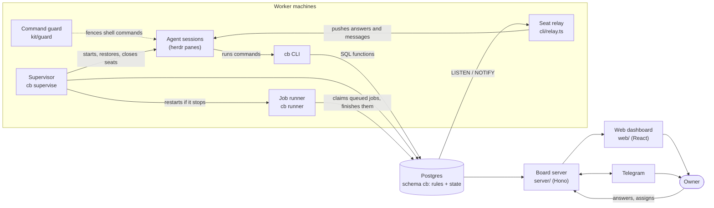

# Agents Board

**A coordination board for many AI coding-agent sessions working at once, across several machines, under one human owner.**

[](package.json)
[](deploy/compose.yml)
[](LICENSE)

Run twenty agent sessions and the problems are not the models: two sessions take the same task, one stalls on a
question nobody sees, a shell command deletes the wrong folder. Agents Board gives the sessions one shared place to
take cards, log what they did, ask the owner a question and keep working, and message each other. Every rule lives in
Postgres as SQL functions, so the CLI the agents use, the web dashboard, Telegram and `psql` all agree.

> Early and opinionated: it is the tool its author runs daily, made public. The Claude Code adapter is the only agent
> adapter so far (see [Current state and limits](#current-state-and-limits)).

## Contents

- [How it works](#how-it-works)
- [Features](#features)
- [Current state and limits](#current-state-and-limits)
- [Quick start](#quick-start)
- [Installing the command guard](#installing-the-command-guard)
- [Repository layout](#repository-layout)
- [Documentation](#documentation)
- [Naming note](#naming-note)
- [Contributing](#contributing)
- [License](#license)

## How it works



- **Postgres** holds the whole model in schema `cb` (`db/schema.sql`, applied by `db/setup.ts`). Every behaviour is a
  `cb.*` SQL function; every write records an actor and lands in the event history. Changes `NOTIFY`.
- **`cb`** (`cli/cb.ts`, `bin/`) is what agent sessions call: take a card, log, ask the owner a question, pass or fail a
  card, hand off, tell another session. It talks to Postgres directly and documents itself (`cb help`, `cb start`).
- **The relay** (`cli/relay.ts`) is one process per seat. It `LISTEN`s on the board and pushes answers and messages
  into the running agent session through that agent's adapter.
- **The server** (`server/main.ts`) serves the web UI, the HTTP API (including `/api/rpc/<function>`), live updates
  over server-sent events and `/healthz`. It also runs the Telegram poller and a GitHub watch.
- **The web dashboard** (`web/`, React + Vite) and **Telegram** are how the owner reads questions and answers them.
  Teammates can sign in with a member role and see only what is handed to them.
- **Squads** are a lead plus role seats (architect, owner, builder, reviewer, qa, investigator) described by a squad
  file (`cb squad set`) and started by `cb squad up` (`cli/squad-up.ts`) as agent sessions in herdr terminal panes.
- **The supervisor** (`cb supervise`, `cli/supervise.ts`) keeps supervised squads in line with their queues: it starts
  seats for waiting cards, restores a seat that went down holding cards, closes seats idle for 20 minutes that hold
  nothing, and restarts the runner when it stops beating.
- **The job runner** (`cb runner`, `cli/runner.ts`) runs test and build recipes for queued jobs in slot clones on one
  machine, so heavy checks do not run inside the agent sessions. Sessions queue them with `cb run`.
- **The command guard** (`kit/guard/`) is a fail-closed check on an agent's shell commands, with per-role rules.

## Features

| Area | What you get |
|---|---|
| Cards | Projects, cards with stages, priorities, tags, epics, goals; design pages with versions; blockers |
| Questions | `cb ask` with options and a recommended one; the session keeps working; the answer is pushed back |
| Messaging | `cb tell`, huddles, broadcasts, delivered into the live session by the relay |
| Owner surfaces | Web dashboard with live updates, Telegram bot, `psql`, HTTP API |
| Squads | Roles, per-role models and permission files, areas with one owner each, several repos per project |
| Supervision | Start, restore and close seats automatically; restart the runner |
| Jobs | Queued test and build recipes run in slot clones, with logs served to peers |
| Safety | Every write has an actor; only the owner acts as owner; a fail-closed shell guard; untrusted text marked as such |
| Agent-neutral core | An `AgentAdapter` interface and registry (`cli/agents/`); sessions carry an agent; relays are keyed per seat |

## Current state and limits

- **Claude Code is the only adapter.** `cli/agents/index.ts` knows the kinds `claude`, `codex`, `opencode` and `agy`,
  but only `claude` has an adapter; asking for another throws ("not installed yet") rather than silently starting
  Claude. Agent-neutral today: the seat relay and its keying, the supervisor's close and status logic, the `agent`
  field in squad files and sessions, and the guard core. Claude-only today: the launch flags and permission files
  (`kit/permissions/`), message delivery (Claude Code's messaging socket), the SessionStart and PreToolUse hooks
  (`hooks/`, `kit/guard/shim-claude.mjs`) and the `AskUserQuestion` block.
- **Squads need herdr.** `cb squad up` and the supervisor start panes through the `herdr` CLI.
- **The guard is a fence for agent mistakes, not a security boundary.** It matches command text and fails closed on
  what it cannot read, but a determined agent or person can get around it.
- **Machines trust each other by the database password.** A session's `cb` connects to Postgres directly; whoever has
  the password can read and change everything. Do not expose Postgres publicly. Session names are labels, not
  authentication.
- **The supervisor, the runner and the herdr wiring were built for the author's setup** (a Windows PC and a Mac).
  Treat them as a working reference, not a polished product.
- The private Postgres cluster that `pnpm run setup` creates is Windows-only (see Quick start). Elsewhere, bring your
  own Postgres 16.

## Quick start

### Prerequisites

- Node 24 or newer (`engines.node` is `>=24`; the repo pins `24.21.0` with Volta). Node runs the `.ts` files directly;
  only the web UI is compiled.
- pnpm 10 (the Dockerfile builds with `pnpm@10.33.0`).
- PostgreSQL 16 (`deploy/compose.yml` runs `postgres:16`). On Windows, `pnpm run setup` creates a private cluster in
  `.pgdata/` with the binaries from `C:/Program Files/PostgreSQL/16/bin` (override with `CB_PG_BIN`). On macOS or
  Linux, run your own Postgres 16 (for example the Docker image) on `127.0.0.1:5434`, with a `cb` user that has trust
  access and may create databases, or point `CB_DATABASE_URL` at one.
- Optional: `herdr` for squads, Docker for the server deployment, `gh` for the GitHub watch.

### Install and set up

```bash
pnpm install
pnpm run setup      # creates the database if missing, applies db/schema.sql (safe to re-run)
pnpm start          # builds web/dist if missing, then serves on http://localhost:4747
```

`pnpm seed` loads synthetic demo projects; `node db/seed.ts --remove` deletes them. On Windows, `setup` also puts
`bin/` on your user PATH so `cb` works in new terminals; elsewhere add `bin/` to your PATH yourself. Then, in an agent
session, run `cb start`: it says who the session is and what to do next.

### Configure

`.env` is git-ignored. `.env.example` has one key, `DATABASE_URL` (default `postgres://cb@127.0.0.1:5434/claude_board`).
Other settings the code reads, all optional:

| Key | Used for |
|---|---|
| `CB_DATABASE_URL` | Overrides `DATABASE_URL`; how `cb` and the server find Postgres |
| `PORT`, `HOST` | The server's port (4747) and bind address (127.0.0.1) |
| `CB_PUBLIC_URL` | The board's public address, used in links to members |
| `CB_TRUST_LOCAL` | `0` turns off sign-in-free access for plainly local requests (set on a server) |
| `CB_BEHIND_CLOUDFLARE` | `1` only when every request really arrives through Cloudflare |
| `TELEGRAM_BOT_TOKEN` | Enables the Telegram bot (one poller per bot) |
| `CB_MACHINE` | This machine's name on the board |
| `CB_RUNNER_CONFIG`, `CB_RUNNER_HOME`, `CB_SUPERVISOR_HOME` | Where the runner and supervisor keep config and logs |

Never commit or paste `.env`, `deploy/.env` or a token.

### Develop the web UI

```bash
pnpm start          # the API on 4747
pnpm dev            # Vite dev server; proxies /api to 127.0.0.1:4747 (CB_API overrides)
pnpm build          # tsc + vite build: the UI's type check
```

### Run the tests

```bash
CB_TEST_DB=claude_board_test node --test --test-concurrency=1 test/auth.test.ts   # one file
CB_TEST_DB=claude_board_test pnpm -s test                                         # the whole suite
```

Tests expect Postgres on `127.0.0.1:5434` as user `cb` and **only ever touch databases named `claude_board_test*`**:
`test/helpers.ts` refuses any other `CB_TEST_DB`, because each test run truncates every table. Use a distinct
`CB_TEST_DB=claude_board_test_<name>` per parallel worktree. On Windows the test setup starts the private cluster for
you; elsewhere have Postgres running first. A Windows git worktree gets its own cluster on its own port instead of
5434 (stop it with `node db/setup.ts --test --stop` before removing the worktree). Never point the tests at a board you
care about. A few files
(`test/agents.test.ts`, `test/guard.test.ts`) are pure and need no database.

### Deploy with Docker Compose

`deploy/compose.yml` runs Postgres 16 and the board together; the board container applies the schema on every start.

```bash
cd deploy
cp env.example .env && chmod 600 .env   # fill in CB_PG_PASSWORD (and the optional keys)
docker compose up -d --build
curl -s localhost:4747/healthz          # {"ok":true}
```

`deploy/env.example` documents each key (`CB_PG_PASSWORD`, `CB_PG_BIND`, `CB_PUBLIC_URL`, `CB_BEHIND_CLOUDFLARE`,
`CB_PROXY_NETWORK`, `CB_MACHINE`, `TELEGRAM_BOT_TOKEN`, `GH_TOKEN`, `CB_PORT`). Bind Postgres to a private network
address, never `0.0.0.0`. HTTPS in front, the first admin, backups and upgrades are in
[docs/ops/deploy.md](docs/ops/deploy.md) and [docs/ops/maintain.md](docs/ops/maintain.md).

## Installing the command guard

Install it per machine, deliberately: it changes the agent's own settings, which every session on that machine reads.

1. From the checkout: `node kit/guard/install.mjs`. It probes the guard and copies it to `~/.claude-board/guard`
   (`--target <dir>` changes that). `node kit/guard/install.mjs --check` exits 0 when the installed files match the
   checkout.
2. In `~/.claude/settings.json`, point a `PreToolUse` hook command at
   `node <your-home>/.claude-board/guard/shim-claude.mjs`, using the absolute home path (not `~`). On Windows set the
   hook's matcher to `Bash|PowerShell` so the PowerShell tool is covered; elsewhere `Bash`.
3. Check it: pipe `{"tool_input":{"command":"ls"}}` into the shim and it prints `{}`; a destructive command prints a
   block decision; malformed input blocks rather than allows.

Always install the whole `kit/guard/` folder with the installer: `core.mjs` and `shim-claude.mjs` depend on each other,
and copying one file alone breaks the hook. Squad seats get `CB_ROLE` (role rules) and `CB_PROTECTED_BRANCHES`
(pushes to those branches are blocked) in their pane. The full procedure, with the smoke checks, is in
[docs/ops/maintain.md](docs/ops/maintain.md#installing-the-guard-on-a-machine).

## Repository layout

| Path | What |
|---|---|
| `db/` | `schema.sql` (the model and every rule), `setup.ts`, `seed.ts`, the private-cluster helper |
| `server/` | Hono server: API, auth, live updates, `rpc.ts`, the Telegram and GitHub pollers |
| `web/` | React dashboard (Vite) |
| `cli/` | `cb` and its manual (`cb.ts`, `help.ts`), relay, squad-up, supervisor, runner, `agents/` adapters |
| `bin/` | The `cb` launchers (POSIX and Windows) |
| `hooks/` | Claude Code hooks: SessionStart pointer, AskUserQuestion block, relay endpoint |
| `kit/` | `guard/` (command guard), `permissions/` (per-role Claude settings), `hooks/` (legacy wrapper) |
| `prompts/` | What sessions, orchestrators and roles are given |
| `deploy/`, `Dockerfile` | Compose file, env template, backup script |
| `docs/` | Operations docs, design specs, onboarding |
| `test/` | `node --test` suite |

## Documentation

- [docs/ops/README.md](docs/ops/README.md): what the board is, its parts, who can do what, the security model
- [docs/ops/deploy.md](docs/ops/deploy.md): deploying to a server
- [docs/ops/maintain.md](docs/ops/maintain.md): upgrades, backups, the guard, the runner, the supervisor, squad files
- [docs/onboarding.md](docs/onboarding.md): onboarding an agent and a project
- [docs/users.md](docs/users.md): users and sign-in
- [docs/superpowers/specs/](docs/superpowers/specs/): design specs (squads, supervisor, job runner, agent-neutral core, and more)
- [CLAUDE.md](CLAUDE.md): the guide for coding agents working in this repo
- `cb help`: the CLI's own manual

## Naming note

The repository is now **agents-board**, but the code keeps its earlier names for now: the CLI is still `cb`, local state
lives in `~/.claude-board`, the database is `claude_board`, the schema is `cb`, and the variables are `CB_*`. What
people and agents read says Agents Board (#4531): the web UI, the help and hook text, and the `[Agents Board]` tag on
relayed messages. The board's own project keeps its short name `claude-board`.

## Contributing

Branch from `main`, keep a change to one concern, write the failing test first and run the test files you touch (see
[CLAUDE.md](CLAUDE.md) for conventions). Commit messages follow conventional commits (`feat(...)`, `fix(...)`,
`docs(...)`). Do not run the tests against a database you care about.

## License

[MIT](LICENSE). Use it, change it, ship it; keep the copyright line.
